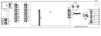
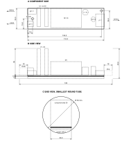

# Foreword

Team sevenUP prepares and maintains the hardware documents of the Vantage sensor node. The design files, the
drawings and these documents are kept together in the team hardware repository, so that every hardware
revision has a matching set of documents.

This document was prepared by Team sevenUP.

This second edition cancels and replaces the first edition, which described the Rev A schematic only. It applies
to Rev B of the power board, the first revision with a printed circuit board. The main changes are as follows:

- the printed circuit board has been laid out (110 mm × 30 mm, single copper layer, toner transfer), and
  fabrication, assembly and the space the board needs in the enclosure have been added;
- the 3.3 V buck boost module has been replaced by an RT9080 LDO regulator (U5) followed by a MAX40200 ideal
  diode (U3);
- the 5 V boost module has been replaced by an MT3608 boost converter built on the board (U6, L1, D3);
- the battery protection module and the BAT_ISO jumper have been removed; the battery shall be a pack with its
  own protection circuit, and R7 (0 Ω) gives the battery link that can be opened for a current measurement;
- the I2C expansion header J3 has been removed; the bus is reached through J1.

The changes between revisions are recorded in the repository change log (`CHANGELOG.md`).

Questions and proposed changes to this document should be raised as issues in the hardware repository.

# Introduction

The Vantage sensor node is the field unit of a flood monitoring system. It is built from two boards connected by
one cable: the sensor board (see VNT-001) and the power board described here.

The power board keeps the node running from a single lithium ion cell charged by a small solar panel. It
provides the 3.3 V supply of the ESP32-S3, a 5 V supply for the sensors that the ESP32-S3 switches on only while
it measures, and two current monitors that report the solar and battery currents over I2C.

The power board is built as a module of the node. It has the same outline and the same two mounting holes as the
sensor board, so one mounting design takes either board, and it connects to the sensor board through one
cable. On the board, the current monitors and the solar charger are ready made modules that plug into sockets,
so that a faulty function can be repaired by replacing one module. Annex D gives the space that the assembled
board needs in the enclosure.

Like the sensor board, the power board is made by hand with the toner transfer method: one copper layer, wide
tracks and gaps, large pads and hand solderable parts. Two wire links on the component side complete the
connections that one copper layer cannot make.

# 1 Scope

This document specifies the fabrication, assembly, configuration and test of the Vantage power board, Rev B,
and describes its circuit and its interfaces.

It does not cover the sensor board (see VNT-001), the firmware, the solar panel mounting or the enclosure,
except for the space the board needs in the enclosure (Annex D).

# 2 Normative references

The following documents are referred to in the text in such a way that some or all of their content
constitutes requirements of this document. For each, the Rev B file in the hardware repository applies.

- `power-board/Vantage_Power.kicad_sch`, *Vantage — Power board — Schematic*
- `power-board/Vantage_Power.kicad_pcb`, *Vantage — Power board — Printed circuit board*
- `outputs/power-board/Vantage_Power_Copper-Artwork_Letter.pdf` and `Vantage_Power_Copper-Artwork_A4.pdf`,
  *copper artwork, 1:1*
- `outputs/power-board/Vantage_Power_Assembly-Drawing.pdf`, *assembly drawing, 2:1*
- `outputs/power-board/Vantage_Power_BOM.csv`, *bill of materials*
- VNT-001, *Vantage — Sensor board — Fabrication, assembly and test*

# 3 Terms and definitions

For the purposes of this document, the terms and definitions given in VNT-001 and the following apply.

### 3.1

**VBAT**

internal supply rail of the power board, at battery voltage, from which the 3.3 V and 5 V supplies are made

### 3.2

**maximum power point tracking**

charger function that keeps the solar panel at the voltage at which it delivers the most power

### 3.3

**battery management system**

protection circuit that disconnects the cell on over charge, over discharge, over current and short circuit

Note 1 to entry: In Rev B the battery management system is part of the battery pack, not of the power board.

### 3.4

**ideal diode**

circuit that passes current in one direction with a very small voltage drop and blocks reverse current

### 3.5

**module envelope**

space, given as outline dimensions, that the assembled board with its plugged modules and mated plugs needs in
the enclosure

# 4 Abbreviated terms

| Abbreviation | Meaning |
|---|---|
| BMS | Battery management system |
| I2C | Inter integrated circuit (two wire serial bus) |
| LDO | Low dropout (linear regulator) |
| MPPT | Maximum power point tracking |
| PTC | Positive temperature coefficient (resettable) fuse |
| SMD | Surface mount device |
| THT | Through hole technology |
| TVS | Transient voltage suppressor (diode) |

# 5 Description

## 5.1 General

The power distribution is shown in Figure 1. The solar input and the battery both feed the VBAT rail. The 3.3 V
supply and the sensor 5 V are made from VBAT. The main characteristics of the board are given in Table 1. The
component side is shown in Figure 2 and the copper side in Figure 3.

{: .wide}

Figure 1 — Power distribution of the power board

Table 1 — Main characteristics

| Characteristic | Value |
|---|---|
| Outline | 110.0 mm × 30.0 mm, rectangular, the same as the sensor board |
| Base material | Single sided FR-4 copper laminate, 1.6 mm thick, 35 µm copper (recommended) |
| Copper | One layer on the copper side, with a ground fill and thermal reliefs |
| Track width | 0.6 mm for signals and at the SOT-23 pins, 0.6 mm to 1.0 mm for the supplies |
| Minimum clearance | 0.5 mm copper to copper (0.35 mm between SOT-23 pins), 0.8 mm copper to board edge |
| Holes | 36 × 1.0 mm (4 of them for the wire links), 2 × 1.2 mm, 2 × 3.2 mm (see Annex B) |
| Wire links | 2 (W1, W2), on the component side |
| Surface mount parts | 23, all on the copper side (1206, 1812, SMA and SOT-23 packages) |
| Through hole parts | Sockets for U1, U2 and M1; BT1, J1, J2, L1, C9 |
| Plug in modules | 2 INA226 current monitor modules (U1, U2), 1 CN3791 MPPT charger module (M1) |
| Mounting | 2 × M3, H1 at the battery end and H2 at the J1 end, the same positions as on the sensor board |
| Module envelope | 134 mm × 30 mm × 43.6 mm including the mated plugs (Annex D) |

{: .wide}

Figure 2 — Component side (battery end on the left, J1 end on the right)

{: .wide}

Figure 3 — Copper side, seen from the copper side, showing the pads and the surface mount parts

## 5.2 Solar input

The solar panel connects to J2. D1 (SMAJ9.0CA) clamps voltage surges on the panel cable. D2 (SS34) blocks
reverse current and protects against a reversed panel. U1, an INA226 module at I2C address 0x40, measures the
panel voltage after D2 and the panel current. M1, a CN3791 MPPT charger module for a 6 V panel, charges the cell
through the VBAT rail.

## 5.3 Battery

The battery BT1 is a 1S lithium ion pack with a built in BMS, plugged into a 2 way JST XH header. F1 (PTC, 1.5 A)
limits the battery current. U2, an INA226 module at I2C address 0x44, measures the battery voltage and the
battery current in both directions: positive while the cell discharges into VBAT, negative while M1 charges it.
R7 (0 Ω) joins the battery path to VBAT. It may be removed to isolate the battery from VBAT, or replaced by an
ammeter.

C1 (22 µF) and C2 (100 nF) decouple VBAT. TP1 gives access to VBAT.

## 5.4 3.3 V supply

U5 (RT9080-33) is an LDO regulator with a quiescent current of 2 µA that makes 3.3 V from VBAT. R6 (100 kΩ)
holds its enable input high. U3 (MAX40200) is an ideal diode between U5 and the output; it stops the 3.3 V of
the dev board, when the dev board is on USB, from flowing back into U5. C3 (10 µF) and C4 (22 µF) decouple the
regulator output, C5 (10 µF) and C6 (100 nF) the 3.3 V output. TP2 gives access to the 3.3 V supply, which goes
to J1 pin 6, to the INA226 modules and to the I2C pull up resistors.

When the cell falls below about 3.5 V, the 3.3 V output follows the cell, less the dropout of U5 and the drop
of U3 (together about 0.2 V at 300 mA). The ESP32-S3 works down to 3.0 V.

## 5.5 Sensor 5 V

U4 (TPS2051B) is a current limited switch between VBAT and the boost converter. Its enable input is SENS_EN from
J1 pin 3, with a 10 kΩ pull down resistor (R1), so the sensor 5 V is off unless the ESP32-S3 drives SENS_EN high.
U6 (MT3608) with L1 (22 µH) and D3 (SS34) boosts the switched VBAT to 5.0 V, set by R4 (22 kΩ) and R5 (3.0 kΩ)
from the 0.6 V feedback reference of U6. C7 (22 µF) decouples the boost input, C8 (22 µF) and C9 (220 µF) the
output. TP3 gives access to the sensor 5 V, which goes to J1 pin 4.

With U4 off, the boost converter has no input, so no current flows from the cell to the sensors.

## 5.6 I2C bus

The I2C bus runs from the sensor board through J1 pins 1 and 2 to U1 and U2. R2 and R3 (4.7 kΩ) are the pull up
resistors of the bus. Many INA226 modules carry their own pull up resistors, often 10 kΩ; with two such modules
the total pull up is about 2.4 kΩ, which the bus accepts.

## 5.7 Interfaces

The connectors and test points are listed in Table 2. The test points are bare pads on the copper side.

Table 2 — Connectors and test points

| Ref. | Function | Type and pins |
|---|---|---|
| J1 | Sensor board connection | JST XH, 6 way, side entry: 1 I2C_SDA, 2 I2C_SCL, 3 SENS_EN, 4 sensor 5 V, 5 GND, 6 +3V3 |
| J2 | Solar panel | 2 way screw terminal, 3.5 mm: 1 panel +, 2 panel − |
| BT1 | Battery pack | JST XH, 2 way, side entry: 1 cell +, 2 cell − |
| U1, U2 | INA226 modules | 8 way female header, 2.54 mm: IN+, IN−, VBS, ALE, SCL, SDA, GND, VCC as marked on the board |
| M1 | CN3791 module | 4 way female header, 2.54 mm: VIN, GND, GND, BAT as marked on the board |
| TP1 | VBAT | Test pad |
| TP2 | +3V3 | Test pad |
| TP3 | Sensor 5 V | Test pad |
| TP4 | GND | Test pad |

The pin assignment of J1 shall match J1 of the sensor board (VNT-001, Annex C).

# 6 Safety

WARNING — A lithium ion cell can deliver very high current. Do not short its terminals or its lead. Connect the
cell last and disconnect it first. Do not use or charge a damaged, swollen or deeply discharged cell.

WARNING — Check the polarity of the battery lead and of the panel cable before connecting them.

The warnings of VNT-001, Clause 6 on etching, solvents, drilling and soldering apply to the fabrication and the
assembly of this board.

# 7 Materials and tools

The parts are listed in Annex A. The materials and tools are those of VNT-001, Clause 7, with the following
additions:

- drill bits: 1.0 mm, 1.2 mm and 3.2 mm, as for the sensor board;
- wire: insulated wire, about 0.6 mm conductor (for example a single core from a network cable), for W1;
  bare tinned copper wire, about 0.6 mm, for W2;
- a fine tip and fine solder (0.5 mm) for the SOT-23 parts;
- double sided foam tape, if the CN3791 module is connected by wires (10.1).

# 8 Fabrication of the printed circuit board

The board shall be made as specified in VNT-001, Clause 8, with the following differences.

1. The copper artwork shall be printed from `Vantage_Power_Copper-Artwork_Letter.pdf` or
   `Vantage_Power_Copper-Artwork_A4.pdf`. The acceptance limits of VNT-001, 8.1 apply unchanged: scale line
   100.0 mm ± 0.5 mm, outline 110.0 mm × 30.0 mm ± 0.5 mm.
2. The copper text reads "VANTAGE POWER B" when the finished board is seen from the copper side.
3. A 1.0 mm ground track runs between the two pads of D2. After etching, check that it is separate from both
   pads along its whole length.
4. The holes shall be drilled with the sizes given in Table B.1. H2 is 2 mm from the board edge, as on the
   sensor board; drill it slowly.

# 9 Assembly

## 9.1 General

Through hole parts are placed on the component side and soldered on the copper side. Surface mount parts are
placed and soldered on the copper side. The positions are shown in Figures 2 and 3 and in the assembly drawing.

The parts shall be fitted in the order of Table 3, so that each part can still be reached for soldering.

Table 3 — Order of assembly

| Step | Part | Side | Remarks |
|---|---|---|---|
| 1 | Wire links W1 and W2 | Component | Flat on the board. W1 runs under the CN3791 module and shall be insulated wire. Positions in Table B.2. |
| 2 | U3, U4, U5, U6 | Copper | SOT-23. Orientation in Table 4. Check the pins for bridges with a magnifier. |
| 3 | R1 to R7 | Copper | 1206. Values in Annex A. |
| 4 | C1 to C8 | Copper | 1206. |
| 5 | F1 | Copper | 1812. |
| 6 | D1, D2, D3 | Copper | SMA. Orientation in Table 4. |
| 7 | L1 | Component | Radial, either way round. |
| 8 | Sockets for U1, U2 and M1 | Component | Female headers. Keep them square to the board. |
| 9 | BT1, J1 | Component | JST XH side entry. |
| 10 | J2 | Component | Wire entry towards the battery end. |
| 11 | C9 | Component | Polarity in Table 4. |

## 9.2 Orientation

The parts in Table 4 shall be fitted in the orientation given. "H2 edge" is the long edge of the board next to
the mounting hole H2. On every connector and socket, pin 1 has a square pad.

Table 4 — Orientation of polarized parts

| Part | Orientation |
|---|---|
| U3, U4, U5, U6 | The side with pins 1 to 3 towards the J1 end, pin 1 (dot) nearest the H2 edge |
| D1 (SMAJ9.0CA) | Either way round (bidirectional) |
| D2 (SS34) | Cathode band towards the H2 edge |
| D3 (SS34) | Cathode band towards the J1 end |
| C9 | Positive lead in the square pad, negative stripe towards M1 |
| BT1 | Opening of the housing towards the battery end; the lead leaves past the board end |
| J1 | Opening of the housing towards the J1 end; the cable leaves past the board end |
| J2 | Wire entry towards the battery end |
| INA226 modules in U1, U2 | Each module pin in the socket contact with the same name; the components of the module then face the battery end |
| CN3791 module in M1 | As given in 10.1 |

## 9.3 Soldering

Solder as specified in VNT-001, 9.3. For each SOT-23 part, tin one corner pad, hold the part in place with
tweezers and reflow that pad, check the alignment of all pins, then solder the other pins. Remove any bridge
with desoldering braid and flux.

# 10 Configuration

## 10.1 Modules

The modules shall be prepared as follows before they are fitted.

1. U2 shall be set to I2C address 0x44 with the address pads of the module (A1 to VS, A0 to GND). U1 stays at the
   default address 0x40 (A1 and A0 to GND).
2. Each INA226 module shall carry a right angle 8 way male header, so that it stands upright in its socket. The
   pin order of the module shall be IN+, IN−, VBS, ALE, SCL, SDA, GND, VCC, as marked on the board. A module
   with another pin order shall not be plugged in.
3. M1 shall be the version for a 6 V panel, or its maximum power point shall be set for the panel in use as given
   in the module documentation. Its charge current shall not exceed the rating of the battery pack and should
   not exceed 0.8 A, the measuring range of an INA226 module with a 0.1 Ω shunt (see Annex C).
4. The CN3791 module connects to the M1 socket with four contacts: VIN to the panel input of the module, BAT to
   its battery output and both GND contacts to its ground. If the module has these four pads in one row in this
   order, fit a 4 way male header and plug it in with its components up. Otherwise solder four short wires,
   ending in a 4 way male header, to the module, and fix the module flat on the area marked M1 with double sided
   foam tape, components up.
5. The battery pack shall be a 1S lithium ion pack with a built in BMS and a JST XH 2 way plug, pin 1 positive.

## 10.2 Cable to the sensor board

The cable shall be as specified in VNT-001, 10.3: a 6 way JST XH cable wired pin 1 to pin 1, no longer than
0.3 m.

# 11 Inspection and testing

## 11.1 General

The tests shall be made in the order of this clause, before the power board is connected to a sensor board.
A board is accepted when every test passes. Equipment: a bench supply with an adjustable current limit, a
digital multimeter, and an I2C controller (for example the sensor board connected through the cable, or a 3.3 V
USB I2C adapter on J1 pins 1, 2 and 5). The results should be recorded on the form in Annex E.

## 11.2 Visual inspection

Check that all parts are fitted in the right position and orientation (Tables 3 and 4), that all joints are
shiny and fully wetted, and that no solder bridge, flux residue or loose wire remains. Check the SOT-23 pins and
the gap under D2 with a magnifier.

## 11.3 Resistance checks

Make the checks in Table 5 with no battery, no panel and all modules removed. "U2 IN+" means the contact of the
U2 socket marked IN+; the other socket contacts are named in the same way.

Table 5 — Resistance checks

| No. | Between | Expected |
|---|---|---|
| R-1 | TP4 and J1 pin 5, BT1 pin 2, J2 pin 2, both M1 GND contacts, the negative pad of C9, in turn | Below 1 Ω (checks the ground under D2 and W2) |
| R-2 | J1 pin 6 and U1 VCC, U2 VCC, TP2, and the pad of C6 towards the H2 edge, in turn | Below 1 Ω (the last one checks W1) |
| R-3 | TP1 and TP4 | Above 100 kΩ after C1 has charged |
| R-4 | TP2 and TP4 | Above 10 kΩ after C5 has charged |
| R-5 | TP3 and TP4 | 25 kΩ ± 5 % after C9 has charged (R4 + R5) |
| R-6 | J1 pin 3 and TP4 | 10 kΩ ± 5 % (R1) |
| R-7 | J1 pin 1 and J1 pin 6; J1 pin 2 and J1 pin 6 | 4.7 kΩ ± 5 % each (R2, R3) |
| R-8 | BT1 pin 1 and U2 IN+ | Below 1 Ω (F1) |
| R-9 | U2 IN− and TP1 | Below 1 Ω (R7) |
| R-10 | U1 IN− and M1 VIN; M1 BAT and TP1 | Below 1 Ω each |
| R-11 | D2, diode test, red lead on J2 pin 1, black lead on U1 IN+ | 0.15 V to 0.45 V; open with the leads reversed |

## 11.4 Supply tests

Fit the modules (10.1). Leave the battery and the panel disconnected. Set the bench supply to 3.7 V with a
current limit of 0.3 A and connect it between TP1 (+) and TP4 (−). The results shall be as given in Table 6.

Table 6 — Supply tests

| No. | Test | Pass condition |
|---|---|---|
| S-1 | Supply current, J1 pin 3 open | Below 5 mA |
| S-2 | Voltage TP2 to TP4 | 3.20 V to 3.40 V |
| S-3 | Voltage TP3 to TP4, J1 pin 3 open | Below 0.3 V |
| S-4 | Voltage TP3 to TP4, J1 pin 3 connected to J1 pin 6 | 4.80 V to 5.20 V |
| S-5 | Supply current, J1 pin 3 connected to J1 pin 6 | Below 20 mA |
| S-6 | Voltage TP2 to TP4 with the bench supply set to 4.2 V, then 3.4 V | 3.20 V to 3.40 V at 4.2 V; 3.10 V to 3.40 V at 3.4 V |

## 11.5 I2C tests

With the bench supply still connected, connect the I2C controller and scan the bus. The results shall be as given
in Table 7.

Table 7 — I2C tests

| No. | Test | Pass condition |
|---|---|---|
| I-1 | Bus scan | Devices found at 0x40 and 0x44, and no others |
| I-2 | U1 bus voltage and current, no panel | Close to 0 V and 0 mA |

## 11.6 Tests with the battery and the panel

Disconnect the bench supply. Check that the pack voltage is between 3.0 V and 4.2 V and that the polarity of its
plug is correct, then plug it into BT1. Then connect the panel in daylight, or a bench supply set to 6.0 V with a
current limit of 0.5 A, to J2. The results shall be as given in Table 8.

Table 8 — Tests with the battery and the panel

| No. | Test | Pass condition |
|---|---|---|
| B-1 | U2 bus voltage compared with the voltage TP1 to TP4 | Within ± 0.05 V |
| B-2 | U2 current, no panel, J1 pin 3 open | Positive (discharge), below 5 mA |
| B-3 | U1 bus voltage with the panel connected | Panel voltage less 0.3 V to 0.5 V (drop of D2) |
| B-4 | U2 current with the panel connected and M1 charging | Negative (charging) |

## 11.7 Test with the sensor board

Connect the sensor board as specified in VNT-001, 10.3 and carry out the field mode tests of VNT-001, 11.6.

# Annex A (normative) Bill of materials

Table A.1 lists the parts fitted to the board. Table A.2 lists the modules and the other items needed to
complete the power part of a node. `Vantage_Power_BOM.csv` holds Table A.1 in machine readable form.

Table A.1 — Parts fitted to the board

| Item | Qty | Reference | Value | Package | Side |
|---|---|---|---|---|---|
| 1 | 1 | BT1 | 1S PACK (BMS) | JST S2B-XH-A, XH 2 way side entry | Component |
| 2 | 4 | C1, C4, C7, C8 | 22 µF | 1206, X5R or X7R, ≥ 10 V | Copper |
| 3 | 2 | C2, C6 | 100 nF | 1206, X7R, ≥ 10 V | Copper |
| 4 | 2 | C3, C5 | 10 µF | 1206, X5R or X7R, ≥ 10 V | Copper |
| 5 | 1 | C9 | 220 µF 16 V | Radial electrolytic, 6.3 mm, 2.5 mm pitch, at most 11 mm tall | Component |
| 6 | 1 | D1 | SMAJ9.0CA | SMA (DO-214AC), bidirectional TVS | Copper |
| 7 | 2 | D2, D3 | SS34 | SMA (DO-214AC), 3 A 40 V Schottky | Copper |
| 8 | 1 | F1 | PTC 1.5 A | 1812, 1.5 A hold | Copper |
| 9 | 1 | J1 | SENSOR | JST S6B-XH-A, XH 6 way side entry | Component |
| 10 | 1 | J2 | SOLAR | 2 way screw terminal, 3.5 mm pitch | Component |
| 11 | 1 | L1 | 22 µH 1 A | Radial, 8 mm diameter, 5 mm pitch, saturation current ≥ 1 A | Component |
| 12 | 1 | M1 | CN3791 socket | 1 × 4 female header, 2.54 mm | Component |
| 13 | 1 | R1 | 10 kΩ | 1206 | Copper |
| 14 | 2 | R2, R3 | 4.7 kΩ | 1206 | Copper |
| 15 | 1 | R4 | 22 kΩ | 1206, 1 % | Copper |
| 16 | 1 | R5 | 3.0 kΩ | 1206, 1 % | Copper |
| 17 | 1 | R6 | 100 kΩ | 1206 | Copper |
| 18 | 1 | R7 | 0 Ω | 1206 | Copper |
| 19 | 4 | TP1 to TP4 | VBAT, 3V3, 5V, GND | Test pad (copper only) | Copper |
| 20 | 2 | U1, U2 | INA226 sockets | 1 × 8 female header, 2.54 mm | Component |
| 21 | 1 | U3 | MAX40200 | SOT-23-5 (MAX40200AUK) | Copper |
| 22 | 1 | U4 | TPS2051B | SOT-23-5 (TPS2051BDBV) | Copper |
| 23 | 1 | U5 | RT9080-33 | SOT-23-5 (RT9080-33GJ5) | Copper |
| 24 | 1 | U6 | MT3608 | SOT-23-6 | Copper |

Table A.2 — Modules and other items for one node

| Item | Qty | Description |
|---|---|---|
| 1 | 2 | INA226 current monitor module with 0.1 Ω shunt, pins IN+, IN−, VBS, ALE, SCL, SDA, GND, VCC, with a right angle 8 way male header |
| 2 | 1 | CN3791 MPPT solar charger module for a 6 V panel, with a 4 way male header or four wires (10.1) |
| 3 | 1 | 1S lithium ion battery pack (for example one 18650 cell) with built in BMS and JST XH 2 way plug |
| 4 | 1 | Solar panel, 6 V nominal |
| 5 | 1 | Cable, JST XH 6 way, pin 1 to pin 1, 0.3 m maximum (VNT-001, 10.3) |
| 6 | 2 | M3 screw with standoff |
| 7 | — | Insulated wire for W1, bare tinned copper wire for W2, about 0.6 mm |

# Annex B (normative) Drilling and wire links

## B.1 Drill sizes

Table B.1 — Drill sizes

| Drill | Use | Count |
|---|---|---|
| 1.0 mm | Component pins: sockets, BT1, J1, L1, C9 | 32 |
| 1.0 mm | Wire links W1 and W2 (two holes each) | 4 |
| 1.2 mm | Screw terminal J2 | 2 |
| 3.2 mm | Mounting holes H1, H2 (no copper) | 2 |

## B.2 Wire links

The coordinates in Table B.2 are measured on the component side from the corner at the battery end and the H2
edge (top left in Figure 2), X along the board and Y across it.

Table B.2 — Wire links

| Link | From (X, Y) | To (X, Y) | Length | Function |
|---|---|---|---|---|
| W1 | 42.5 mm, 10.1 mm | 42.5 mm, 26.8 mm | 16.7 mm | Carries +3V3 from U3 over the SCL and SDA tracks to the INA226 modules and J1. Insulated wire. |
| W2 | 81.6 mm, 13.7 mm | 88.2 mm, 13.7 mm | 6.6 mm | Carries ground over the boost input track to the sensor 5 V circuit (U4, U6, C7 to C9) |

# Annex C (informative) Current monitors

Common INA226 modules carry a 0.1 Ω shunt resistor, marked R100. The INA226 measures up to 81.92 mV across the
shunt, so the measuring range is about ± 0.8 A. Table C.1 gives the settings that suit this shunt.

Table C.1 — INA226 settings for a 0.1 Ω shunt

| Item | U1 (solar) | U2 (battery) |
|---|---|---|
| I2C address | 0x40 | 0x44 |
| Shunt resistance | 0.1 Ω | 0.1 Ω |
| Current resolution (current LSB) | 0.1 mA | 0.1 mA |
| Calibration register (0.00512 / (current LSB × shunt)) | 512 | 512 |
| Bus voltage measured at | Panel side, after D2 | Battery side, after F1 |
| Sign of the current | Positive from the panel | Positive on discharge, negative on charge |

NOTE If a module carries another shunt value, recalculate the calibration register with the formula in the
table and check the measuring range against the charge current of M1.

# Annex D (informative) Module envelope

Figure D.1 gives the space that the assembled power board needs, at 1:1. The heights are for the parts in
Annex A and should be checked against the modules actually bought. The same drawing, with notes, is in
`outputs/power-board/Vantage_Power_Envelope.pdf`.

The envelope is 134 mm × 30 mm × 43.6 mm: the 110 mm board with 12 mm at each end for the mated plugs and the
bend of their cables, 39 mm above the board for the INA226 modules standing in their sockets, and 3 mm below the
board for the surface mount parts and the solder joints. A round tube that holds the board on its centre line
needs an inner diameter of at least 53 mm; 55 mm leaves room for the mounting.

The battery lead and the panel wires leave at the battery end, the sensor cable at the J1 end. Because both
boards have the same outline and mounting holes, the sensor board and the power board can be placed end to end in
the same tube, each on its own pair of M3 standoffs, with the 0.3 m cable between them.

Figure D.1 — Module envelope of the power board, 1:1 (dimensions in millimetres)

# Annex E (informative) Test record

| Board serial number | Date | Tested by |
|---|---|---|
| &nbsp; | &nbsp; | &nbsp; |

Table E.1 — Test record

| Test | Clause | Measured value | Pass / fail |
|---|---|---|---|
| Visual inspection | 11.2 | | |
| R-1 to R-11 | 11.3 | | |
| S-1 | 11.4 | | |
| S-2 | 11.4 | | |
| S-3 | 11.4 | | |
| S-4 | 11.4 | | |
| S-5 | 11.4 | | |
| S-6 | 11.4 | | |
| I-1 | 11.5 | | |
| I-2 | 11.5 | | |
| B-1 | 11.6 | | |
| B-2 | 11.6 | | |
| B-3 | 11.6 | | |
| B-4 | 11.6 | | |
| Test with the sensor board | 11.7 | | |
| Result: accepted / rejected | | | |

# Bibliography

1. Texas Instruments, *INA226 High-Side or Low-Side Measurement, Bi-Directional Current and Power Monitor with I2C Compatible Interface — Datasheet*
2. Richtek, *RT9080 2µA IQ, 600mA Low-Dropout Linear Voltage Regulator — Datasheet*
3. Analog Devices (Maxim Integrated), *MAX40200 Ultra-Tiny Micropower, 1A Ideal Diode with Ultra-Low Voltage Drop — Datasheet*
4. Texas Instruments, *TPS2051B Current-Limited Power-Distribution Switch — Datasheet*
5. Aerosemi, *MT3608 High Efficiency 1.2MHz 2A Step Up Converter — Datasheet*
6. Consonance Electronics, *CN3791 Solar Lithium-ion Battery Charger with MPPT — Datasheet*
7. JST, *XH Connector — Catalogue*
8. ISO/IEC Directives, Part 2, *Principles and rules for the structure and drafting of ISO and IEC documents* (layout model of this document)
